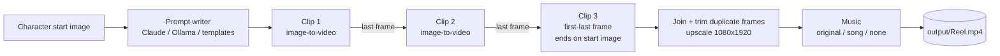

# 🎬 Reel Studio

**Turn one character picture into a finished 10–30 second vertical dance reel with music, in one click.**

Reel Studio is a small local web app for macOS (and Linux) that automates the whole AI-video pipeline for
Instagram Reels, YouTube Shorts and TikTok:

1. it **writes a motion prompt** for every 5-second clip,
2. it **generates every clip on [Comfy Cloud](https://comfy.org/cloud)** with the open-source **Wan 2.2 14B** video model,
3. it **chains the clips**, so each one starts from the exact last frame of the clip before it,
4. it **joins** them into one seamless 1080 × 1920 video, and
5. it **adds music**: an original copyright-free track, your own song, or no audio (for adding a song inside Instagram).

You don't need a GPU. The heavy work runs on Comfy Cloud. Your Mac only runs a light Python server and ffmpeg.

---

## Table of contents

- [Why this exists](#why-this-exists)
- [Features](#features)
- [How it works](#how-it-works)
- [Requirements](#requirements)
- [Installation](#installation)
- [Create your Comfy Cloud account (step by step)](#create-your-comfy-cloud-account-step-by-step)
- [First-time setup](#first-time-setup)
- [Connect, Disconnect and saving credits](#connect-disconnect-and-saving-credits)
- [In-app Help](#in-app-help)
- [Making your first reel (step by step)](#making-your-first-reel-step-by-step)
- [Characters](#characters)
- [Character from a photo (with consent)](#character-from-a-photo-with-consent)
- [Image library](#image-library)
- [Character LoRAs and trigger words](#character-loras-and-trigger-words)
- [The clip plan: prompts, chaining, re-anchoring](#the-clip-plan-prompts-chaining-re-anchoring)
- [Story mode (short films with several characters)](#story-mode-short-films-with-several-characters)
- [Music options](#music-options)
- [Dance that follows the music (beats, energy, lyrics)](#dance-that-follows-the-music-beats-energy-lyrics)
- [Fixing a bad clip / changing music later](#fixing-a-bad-clip--changing-music-later)
- [Time and cost](#time-and-cost)
- [Configuration reference](#configuration-reference)
- [Project structure](#project-structure)
- [Where your files go](#where-your-files-go)
- [Comfy Cloud workflows (and how to swap them)](#comfy-cloud-workflows-and-how-to-swap-them)
- [Local HTTP API](#local-http-api)
- [Troubleshooting](#troubleshooting)
- [Content and safety rules](#content-and-safety-rules)
- [Posting tips](#posting-tips)
- [Known limitations](#known-limitations)
- [Roadmap](#roadmap)
- [Publishing this project on GitHub](#publishing-this-project-on-github)
- [Contributing](#contributing)
- [Credits and licences](#credits-and-licences)
- [Disclaimer](#disclaimer)

---

## Why this exists

Making a single 15-second AI dance reel by hand takes a lot of repetitive steps:

| Manual step | Reel Studio |
|---|---|
| Write a motion prompt for each 5-second clip | Written for you (Claude, Ollama or built-in templates) |
| Open the Wan 2.2 template, upload the start image, paste the prompt, set size and length, click Run | Done through the Comfy Cloud API |
| Wait, then download the clip | Polled and downloaded automatically |
| Extract the last frame, upload it as the next clip's start image | Automatic |
| Use the first–last-frame template for the ending | Automatic |
| Join clips, trim the duplicated frame, upscale | Automatic (ffmpeg) |
| Find or make music and mix it in with fades | Automatic |

A 15-second reel takes about **20 clicks and 30+ minutes of babysitting** by hand. In Reel Studio it takes
**one click and about 5–10 minutes of waiting**.

---

## Features

- 🧒 **Character library**: save any number of characters (child, adult or animal) with a start image,
  look description, outfit, style and an optional LoRA trigger word.
- ✍️ **Automatic prompt writing** with three engines, tried in this order:
  1. **Claude** (if you add an Anthropic API key),
  2. **Ollama** (if it runs on your Mac; any installed model),
  3. **built-in dance templates** (always available, no AI needed).
- 🔗 **Clip chaining**: every clip starts from the previous clip's last frame, so motion flows continuously.
- 🎯 **Identity locking**: the last clip ends exactly on the character's original picture (Wan 2.2
  first–last-frame mode), and long reels re-anchor every 3rd clip to stop the face drifting.
- ⚡ **Turbo mode**: uses the Lightning 4-step LoRA, about 1–2 minutes per clip instead of about 10.
- 🛡️ **Turbo check**: a status chip shows whether Turbo is on. If it is off when a reel starts, resumes or redoes a clip, the app asks you to enable it (through its own `/api/turbo` API) before any credits are spent.
- 🖼 **Upscale** to 1080 × 1920 (Instagram's native Reel size).
- 🎵 **Music**: an original dhol-and-melody track generated on your Mac (no copyright issues), your own MP3/M4A/WAV
  with a chosen start point and fades, or silent.
- ♻️ **Redo from any clip** and **remix music** without paying to regenerate everything.
- 💾 **Everything is saved per reel**: clips, first/last frames, logs and the final video.
- 🔌 **Connect / Disconnect** for Comfy Cloud: a live status light, an emergency stop that cancels cloud jobs at once, and automatic opening of the Comfy Cloud dashboard when the app connects.
- 🖼 **Image library**: comes with sample character images, lets you upload more, tag and search them, use any of them as a character's or a single reel's start image, and save frames from finished clips.
- 🧬 **Character LoRA dropdown** that explains every trigger word. LoRA files are wired into both Wan 2.2 workflows automatically.
- ❓ **Built-in Help page** (`/help`) with setup, credits, LoRA and troubleshooting guides.
- 🔒 **Local and private**: keys stay in `config.json` on your machine; the app only listens on `127.0.0.1`.

---

## How it works



For each clip the app:

1. uploads the start image to Comfy Cloud (`POST /api/upload/image`),
2. fills in your exported **Wan 2.2 workflow** (prompt, size, frames, seed, turbo switch),
3. submits it (`POST /api/prompt`) and polls (`GET /api/job/{id}/status`),
4. reads the outputs (`GET /api/jobs/{id}`), downloads the video through `/api/view` (following the signed URL
   **without** sending your API key to the storage host),
5. extracts the first and last frames with ffmpeg.

After the last clip it joins everything with ffmpeg and mixes the audio.

---

## Requirements

| What | Details |
|---|---|
| Computer | macOS 12+ (Apple Silicon or Intel) or Linux. No GPU needed. Windows works via WSL. |
| Python | 3.9 or newer (`python3 --version`). Get it from [python.org](https://www.python.org/downloads/) if missing. |
| Internet | To install the Python packages once, and to talk to Comfy Cloud. |
| Comfy Cloud | A paid plan (Standard or higher; **Creator** if you want custom LoRAs) and an **API key**. |
| Optional | An Anthropic API key (better prompts) **or** [Ollama](https://ollama.com) running locally. |

You don't need to install ffmpeg yourself: the app uses the `imageio-ffmpeg` package, which includes it.

---

## Installation

```bash
# 1. Get the code
git clone https://github.com/<your-username>/ReelStudio.git
cd ReelStudio

# 2. Start it (the first run creates .venv and installs packages; takes 1–2 minutes)
./run.sh
```

`run.sh` does the following:

1. finds a Python ≥ 3.9,
2. creates a private virtual environment in `.venv/`,
3. installs `requirements.txt` from **public PyPI**, ignoring any custom pip mirror on your machine,
4. if the app is already running, just opens the browser,
5. starts the server, waits until it answers, then opens **http://127.0.0.1:7860**.

Press **Ctrl + C** in the Terminal to stop the app.

> If you get `permission denied`, run `chmod +x run.sh` once, or start it with `bash run.sh`.

To use another port: `PORT=8080 ./run.sh`

---

## Create your Comfy Cloud account (step by step)

Reel Studio uses Comfy Cloud's GPUs to run Wan 2.2. You need an account, a paid plan and an API key.

### 1. Sign up

1. Open **https://comfy.org/cloud** (or go straight to **https://cloud.comfy.org**).
2. Click **Sign up** / **Log in**.
3. Choose **Log in with Google**, **Log in with GitHub**, **Continue with SSO**, or **Use email instead**.
4. Accept the Terms of Use and Privacy Policy. New accounts usually get a few free runs to try the website.

### 2. Choose a plan

1. Open **https://comfy.org/cloud/pricing**.
2. Pick a plan. The **API (which this app uses) needs an active paid subscription**.

| Plan | Typical use with Reel Studio |
|---|---|
| **Standard** | Trying things out; a handful of reels per month |
| **Creator** | Regular reels **and** importing your own models/LoRAs (needed for character LoRAs) |
| **Pro** | Heavy daily production, longer runs, more parallel jobs |
| **Team / Enterprise** | Shared credits for a team |

3. Pay on Comfy's checkout page. Reel Studio never sees payment details.
4. Notes: monthly plan **credits don't roll over**; top-up credits last longer. Prices and credit amounts
   change, so always check the pricing page. You can see your balance and usage in your Comfy account.

### 3. (Optional) Try the website once

In Comfy Cloud: **Templates → search "Wan 2.2 14B" → Image to Video**. Upload a picture, write a short prompt and press
**Run**. If that works, your account and plan are ready.

### 4. Create an API key

1. Go to **https://platform.comfy.org/profile/api-keys**, signed in with the **same account**.
2. Click **Create API key** and name it, for example `Reel Studio – MacBook`.
3. **Copy the key now.** It's usually shown only once.
4. Keep it secret. Anyone with it can spend your credits. If it leaks, delete it there and create a new one.

### 5. Put the key into Reel Studio

**Settings → Comfy Cloud API key → paste → Test key → Save.** Then click **Connect** in the Comfy Cloud bar.
(Or start the app with `COMFY_API_KEY=... ./run.sh`.)

### 6. For character LoRAs (Creator plan or higher)

In Comfy Cloud: **Models (left sidebar) → Import → paste a Hugging Face/Civitai download link → choose `loras`**.
For private Hugging Face repos, first add your HF token in **Comfy Cloud Settings → Secrets**. Imported files appear
under **My Models**. See [Character LoRAs](#character-loras-and-trigger-words).

---

## First-time setup

1. Open **Settings** (top right).
2. **Comfy Cloud API key**: create one at **platform.comfy.org → Profile → API keys**, paste it and click
   **Test key**. You should see "Comfy Cloud key works."
3. *(Optional)* **Claude API key**: from console.anthropic.com. You can also choose the model name.
4. *(Optional)* **Ollama**: tick "Use Ollama" and pick a model (for example `llama3.1`). The app only uses it when
   no Claude key is set.
5. Click **Save**.

The header chips show what's active, for example `Comfy Cloud key set` · `Prompts: Claude`.

You can also pass keys as environment variables instead of saving them:

```bash
COMFY_API_KEY=... ANTHROPIC_API_KEY=... ./run.sh
```

---

## Connect, Disconnect and saving credits

The bar at the top right of the app shows the live state:

| Light | Meaning |
|---|---|
| 🟢 **Connected · idle (no credits used)** | Ready. Comfy Cloud charges only while a GPU is running a job, so idle costs nothing. |
| 🟡 **Connected · N job(s) running** | Clips are being generated. **Credits are being used.** |
| ⚪ **Disconnected (no credits used)** | The app won't send anything to Comfy Cloud. |

- **Connect** checks your API key, turns the light green and **opens the Comfy Cloud website** in your browser so
  you can watch jobs and credits. The site also opens when a reel starts (at most once every 10 minutes). Turn
  this off in **Settings → "Open Comfy Cloud in my browser…"**.
- **Disconnect** (click twice) is the emergency brake. It:
  1. cancels every Reel Studio job still running or queued on Comfy Cloud (`POST /api/queue {"delete": [...]}`),
  2. interrupts the current GPU job (`POST /api/interrupt`),
  3. stops every reel in progress, and
  4. blocks new jobs until you press **Connect**. The state is remembered between restarts.
- Per reel: **Stop after this clip** (no wasted credits) or **Cancel now (stop credits)**.
- Finished clips are always kept, so **Resume** continues where you stopped.

### Credits counter

- The pill next to the cloud status shows **💳 credits left**. It is read from Comfy Cloud's billing API
  (`GET /api/billing/usage/timeseries` → `summary.balance`, reported in cents and converted at **$1 = 211 credits**)
  about once a minute, after each job, and when you click it. Hover for: plan credits, top-up credits, spent this
  month, and the app's own usage.
- Yellow below 600 credits, red below 150. If the API returns no balance for your key, the pill turns grey and shows
  the app's own estimate instead (see the exact number in Comfy Cloud → **Manage plan** → Credit history).
- **Per-reel estimate**: under the clip plan, *"This reel: about N credits (~$X)"* updates as you change length, Turbo or
  Dynamic Turbo, and turns red if your balance is too low. It uses Comfy's rate of 0.266 credits per GPU-second and
  typical clip times (Turbo ≈ 80 s, Dynamic Turbo ≈ 140 s, no Turbo ≈ 560 s). After 3 clips in a mode it uses the
  median of your own last 20 clips instead.
- Each job is logged in `data/usage.json`. This is an estimate based on wall time, so it slightly over-counts.

> Comfy Cloud is serverless and pay-per-use: there's no rented machine that keeps running. "Disconnect" guarantees
> nothing is running or will start, which is the same as shutting the server down from a billing point of view.

---

## In-app Help

Click **Help** (top right) or open **http://127.0.0.1:7860/help**. It covers quick start, creating the Comfy account
and API key, Connect/Disconnect and credits, characters, the image library, LoRAs and trigger words, chaining,
music, fixing clips, troubleshooting and a FAQ.

---

## Making your first reel (step by step)

1. **Character**: click a character card (the sample character **Pari** is included) or **+ Add character**.
2. **Reel**:
   - **Length**: 10, 15, 20, 25 or 30 s (2–6 clips of 5 s).
   - **Setting**: for example "a Diwali courtyard with diyas at night".
   - **Mood or song notes**: for example "happy festive dance, medium tempo". This helps the prompts match the song.
   - **Music**: Original track, My song file (+ start time), or No music.
   - **Turbo** (on by default) and **Upscale** (on by default).
3. Click **Write the clip prompts**. You'll see one editable text box per clip and two switches:
   - **Restart from character image** (re-anchor)
   - **End on character image** (first–last-frame lock)
4. Edit anything you like, then click **Make my reel**.
5. Watch progress: each clip card shows *Uploading → On Comfy Cloud (status, seconds) → Done*, with a
   hover-to-play preview. The **Activity log** shows every step.
6. When it's finished, the reel plays on the page. Use **Show in Finder**, **Download**, or
   **Download without music**.

---

## Characters

Each character is stored in `data/characters.json` and its picture in `data/characters/`.

| Field | Used for |
|---|---|
| Name | Prompts and file names |
| Type | `girl-child`, `boy-child`, `woman`, `man`, `animal`. Child types switch on the safety rules. |
| Style | e.g. *3D animated cartoon*, *Anime*, *Claymation*. Photorealistic is blocked for children. |
| Who they are | e.g. *a cute 5-year-old Indian girl* |
| Look | Face, hair, signature details, repeated in every prompt for consistency |
| Outfit | What they wear **in the start image** |
| LoRA trigger | Optional word put at the start of every prompt if you trained a character LoRA |
| Start image | **The most important input.** One character, full body, vertical, with the background you want in the reel |

**Tips for a great start image**

- Vertical (9:16 or close), full body, character centred and facing the camera.
- The background you want in the reel. A plain studio backdrop gives plain-background clips.
- Make it with any image model (SDXL, Flux, etc.).

---

## Character from a photo (with consent)

**📷 Make a character from a photo** (step 1) turns a photo into an **original illustrated character** that resembles
the person: same face shape, hairstyle, hair colour, skin tone, eye shape, accessories and smile
(`reelstudio/photochar.py`).

- **Consent is required.** A tick-box must confirm that you are the person in the photo or have their permission
  (for a child: you are their parent or guardian, or have their permission). The API refuses without it
  (`consent=yes`), and the date is stored with each result (`consent_confirmed`).
- **Never photorealistic.** Styles are limited to 3D cartoon, anime, claymation and stylised semi-realistic, and the
  prompt requires an illustrated look. Child characters are always cartoon-style and modestly dressed.
- **Privacy.** The photo is resized, sent to Comfy Cloud only for the drawing, and deleted from ReelStudio afterwards.
  It is never added to the library. Only the drawn versions are saved (under "My images").
- 1–3 versions per photo, in different poses (about 5–9 credits each). **Use this one** opens the character form
  already filled in.
- Needs an image-edit model on your Comfy Cloud account (Qwen-Image-Edit 2509, Qwen-Image-Edit or FLUX.1 Kontext).
  There is no text-only fallback, because a photo can't be used without one.
- API: `POST /api/characters/from-photo` (multipart: `photo`, `consent`, `name`, `kind`, `style`, `outfit`, `notes`,
  `variations`) and `GET /api/characters/from-photo/status`.

## Image library

A shared collection of start images, stored in `data/library/` (with titles and tags in `data/library.json`).

- **Sample images included**: Pari's start images ship with the app so you can make a reel straight away.
- **Add images**: **+ Add images** (multi-select PNG/JPG/WEBP), or copy files into `data/library/`. They're picked
  up automatically the next time the library loads.
- **Organise**: edit the title and tags under each picture; search by title or tag.
- **Use**: as a character's start image (Edit character → click a picture), or for **one reel only**
  (step 2 → *Start image for this reel*).
- **Capture**: on a finished clip, **Save last frame to library** to reuse a good pose.
- Uploading a new start image in the character form also adds it to the library.
- **Filters**: All · Girls · Boys · Women · Men · Animals · My images.

### Character gallery (80 ready-made characters)

**✨ Build the character gallery** generates original start images on Comfy Cloud and saves them into the library
(`reelstudio/gallery.py`):

| Group | Count | Styles |
|---|---|---|
| Girls | 16 | 3D cartoon, anime, claymation (child characters are never photorealistic) |
| Boys | 16 | 3D cartoon, anime, claymation |
| Women | 16 | 3D cartoon, anime, claymation, semi-realistic, photorealistic (fictional people) |
| Men | 16 | 3D cartoon, anime, claymation, semi-realistic, photorealistic (fictional people) |
| Animals | 16 | puppy, kitten, baby elephant, panda, monkey, peacock, lion cub, penguin, rabbit, parrot… |

- Every picture is a full-body, front-facing pose with space around it, in a matching festive or everyday setting,
  so it works as a Wan 2.2 start image.
- Cost: roughly 5–7 credits per image (about 400–550 for all 80). Each preset is made once. Pressing the button again
  only makes the missing ones. You can stop at any time.
- **Make a character** on a gallery picture opens the character form already filled in from that preset.
- Images are saved as JPEG (about 0.2 MB each) in `data/library/`, with `kind`, `style`, `look`, `outfit` and `preset`
  stored in `data/library.json`.
- **Image engine**: the app reads your Comfy Cloud model list (`GET /api/experiment/models/<folder>`) and uses the
  first engine whose files exist: **Z-Image Turbo** (8 steps) → **Qwen-Image + Lightning 8-step LoRA** → **Qwen-Image**
  → **SDXL base**. If the list can't be read, it tries them in order. To use any other model, export a text-to-image
  workflow from Comfy Cloud (**File → Export (API)**) as `workflows/t2i_api.json`. The app fills in its prompt, seed
  and size.
- Real photos of people are deliberately not used: making AI dance videos of real people, especially children,
  needs their consent.

## Character LoRAs and trigger words

A **LoRA** is a small add-on model trained on one character. A **trigger word** (a made-up token such as `p4ri`)
switches its look on when it appears in the prompt. **A trigger word does nothing without the LoRA files**, so Reel
Studio only adds the trigger to prompts when the LoRA entry has its files set.

The character form has a **Character LoRA** dropdown that explains each entry:

| Entry | What it does |
|---|---|
| No character LoRA | Look comes from the start image and description only. |
| Lightning 4-step (Turbo) | Built-in speed LoRA, controlled by the Turbo tick box. No trigger word. |
| Pari character LoRA (not trained yet) | Sample entry, trigger `p4ri`; inactive until you add the trained files. |
| Your LoRAs | Added with **Manage LoRAs**: name, trigger, what it does, high-noise file, low-noise file, strength. |

When a LoRA with files is selected, the app inserts a `LoraLoaderModelOnly` node in front of each
`ModelSamplingSD3` node (the high-noise file on the high-noise model, the low-noise file on the low-noise model),
in both the image-to-video and the first–last-frame workflows, and starts every prompt with the trigger word.

**Training a Wan 2.2 character LoRA (overview)**

1. Make 12–20 consistent images of the character: varied angles, close-ups and full body, 2–3 outfits, several
   expressions and backgrounds. Add them to the library.
2. Caption each image starting with the trigger word, e.g. `p4ri, three-quarter view, smiling, festive courtyard`.
3. Train a **Wan 2.2 14B** LoRA (for example fal.ai "Wan 2.2 14B Image Trainer", Civitai's trainer, or Ostris
   AI Toolkit on a rented GPU). You get a **high-noise** and a **low-noise** `.safetensors` file.
4. Upload both to Hugging Face or Civitai, then import them into Comfy Cloud (**Models → Import → `loras`**).
5. In Reel Studio: **Manage LoRAs → Edit** → enter the exact file names from *My Models* → Save → pick it in the
   character's dropdown. Strength 0.8–1.0 is typical.

Saved LoRA entries live in `data/loras.json`.

---

## The clip plan: prompts, chaining, re-anchoring

Wan 2.2 makes about **5 seconds per generation** (81 frames at 16 fps). Longer reels are built from several clips:

| Reel | Clips | Default plan |
|---|---|---|
| 10 s | 2 | clip 2 ends on the start image |
| 15 s | 3 | clips chained; clip 3 ends on the start image |
| 20 s | 4 | clip 3 ends on the start image, clip 4 restarts from it and ends on it |
| 30 s | 6 | lock/restart every 3rd clip; the last clip ends on the start image |

- **Chained clip**: starts from the previous clip's last frame. In the final video its first frame is trimmed, so
  the shared frame doesn't stutter.
- **Re-anchored clip** ("Restart from character image"): starts from the original image again. This undoes any
  slow face or outfit drift. The clip before it is locked to end on the same image, so the cut is seamless.
- **Locked end** ("End on character image"): uses the **first–last-frame** workflow, so the clip has to land
  exactly on the original picture.

Every prompt follows this pattern:

```
<style>. <name>, <who>, <look>, wearing <outfit>, in <setting>.
She starts <previous end pose>. She <moves>, and ends <end pose>.
The face, hair and outfit stay exactly the same. Smooth gentle motion, soft warm lighting, <camera>. Vertical video.
```

---

## Story mode (short films with several characters)

Switch step 2 from **💃 Dance reel** to **🎬 Story**.

**Lengths:** 20 s (4 shots) up to **2½ minutes (30 shots)**. For stories of 12 shots or more, the AI writer first plans
**scenes** (an outline with a beginning, middle, turning point and ending), then writes each scene's shots with the story
so far and the previous shot's last pose as context, so the film stays consistent. The built-in writer (no AI key)
builds long stories from ready-made scenes (finding, walk, playtime, rain, celebration), which is fine for testing.
A 2-minute story is about 24 clips and 30–40 keyframes, roughly 1,100–1,500 credits and 1–1½ hours of cloud time.
**Compact view** hides the detail fields of long shot lists. Stop and Resume keep finished shots. A dance is one continuous take; a story is a series of
**shots** (5 seconds each) with cuts, props, emotions and narration.

**Flow:** pick the cast (up to 4; the first is the main character) → idea, length (4–10 shots), setting, tone,
narration language (Hindi / English / none), voice, music → **Write the story** → edit the shot cards →
**1 · Make keyframes** (check, redo, upload or approve each) → **2 · Make the video** → final short in `output/`.

### Writing the story: writers, ideas and the story builder

- **Story writer**: *Automatic*, *Claude* (API key), **any Ollama model installed on your Mac** (each one is listed
  from `GET /api/tags`), or *Built-in*. Ollama calls use **structured outputs** (a JSON schema for the shot list,
  outline, ideas and brief, so small local models stay on track), a 16k context and progress updates in the UI.
  Older Ollama versions without schema support fall back to plain JSON mode.
- **💡 Give me 3 ideas**: three ideas that use the whole cast (`POST /api/story/brainstorm {mode:"ideas"}`).
- **✨ Expand my idea into a full story**: a complete story brief, with roles for each character, wish, problem, attempts,
  turning point, ending, message and 6–10 plot beats (`mode:"expand"`). It fills the **Story builder**, and what you
  already typed is kept. The brief is sent with the idea to the shot-list writer, so every scene follows it.
- Cast of up to **6 characters** (3–4 recommended); every cast member gets at least one moment, and up to 3 per shot.
- Formula for a good idea: **WHO + WANTS + BUT + SO + THEN + FINALLY**, plus a role and trait for each character,
  big visible actions, simple props and only two or three places.

### Why stories need different prompts (hands, eyes and limbs)

Video models fail most often when hands touch objects or limbs do complex things. The planner (`reelstudio/story.py`)
and every prompt follow these rules:

| Rule | Why |
|---|---|
| One clear action per shot | Several actions in 5 s blur together and break limbs |
| Timed beats: 0–2 s, 2–4 s, 4–5 s | Gives the model a clear order of movements |
| Eyes lead the hand ("looks at the ball, then reaches with the right hand") | Natural hand–eye coordination |
| Name the hand, the object and its place | Stops random hands and floating props |
| Big, simple props (ball, kite, balloon, gift box, puppy) | Thin objects (pens, phones, spoons, laces, keys) morph; the app warns and suggests swaps |
| Close-ups for hand moments, wide shots for whole-body moves | Hands get enough pixels; bodies get enough room |
| **Start + end keyframes** for touching, giving, catching, hugging | The model only fills the motion between two correct pictures. This is the biggest quality gain |
| Hand/limb negative prompt | extra or fused fingers, twisted wrists, props melting, floating or changing size |

Each shot has a **mode**: `i2v` (new shot from a start keyframe), `flf` (start + end keyframes) or `continue`
(continues the previous shot's last frame, no cut).

### Keyframes (`reelstudio/imagegen.py`)

Keyframes are made with an **image-edit** model that receives the characters' own images, so faces and outfits stay
consistent: **Qwen-Image-Edit 2509** (up to 3 reference images, with the Lightning 4-step LoRA if present) →
**Qwen-Image-Edit** → **FLUX.1 Kontext** → plain text-to-image as a last resort. Model files are found by name
in your Comfy Cloud model list. End keyframes are edits of the start keyframe ("same scene, change only the pose…").
You can also upload your own keyframe for any shot, or export your own edit workflow as `workflows/edit_api.json`.

### Sound, subtitles and assembly (`reelstudio/story_pipeline.py`)

- **More voices**: 25 built-in choices (Hindi Swara/Madhur, Marathi-accent Aarohi/Manohar, the multilingual
  Ava/Emma/Andrew/Brian voices that also speak Hindi, Indian, US, UK and Australian English, children and storytellers).
  **Show all voices** loads every Hindi, English and multilingual Edge voice (`GET /api/story/voices?all=1`).
  Each speaker also has their own **speed**.
- **Multiple voices**: each shot has up to 3 spoken `lines` `[{speaker, text}]`. The speaker is `Narrator` or a cast member,
  and every speaker has their own voice and pitch (`story_settings.voices`, e.g. `{"Narrator": {"voice": "hi-IN-MadhurNeural", "pitch": 0},
  "Pari": {"voice": "hi-IN-SwaraNeural", "pitch": 25}}`). Defaults by character type: child = higher voice, adult = male or
  female voice, animal = very high. Set them in the story form, or change them later under **Change the voices or music**
  (free, no cloud). `POST /api/story/voice-test {voice, pitch}` plays a sample.
- **Narration** (`reelstudio/tts.py`): Microsoft Edge neural voices via `edge-tts` (installed automatically on first use;
  needs internet): Hindi Swara/Madhur, English (India) Neerja/Prabhat, child-like Ana/Maisie, storytellers Jenny/Guy.
  The macOS `say` voices are the offline fallback. If a line is longer than its shot, the shot is slowed (up to 1.25×)
  and then held on its last frame so the words fit.
- **Subtitles** (`reelstudio/subs.py`) are **always generated but never forced**: you get `story_final.mp4` (clean),
  `story_final_subtitled.mp4` (drawn on, Hindi supported with proper text shaping) and `subtitles.srt`.
  Preview either one and download the version you want. All three are also copied to `output/`.
- **Sound effects** (`reelstudio/sfx.py`): 12 built-in effects made with numpy (chime, sparkle, pop, whoosh, boing,
  footsteps, clap, birds, rain, wind, drumroll, heartbeat); add your own WAV/MP3 files to `data/sfx/`.
- **Music**: soft original track or one of your songs, automatically lowered under the voice (side-chain ducking).
- **Change the voice or music** re-makes the soundtrack in seconds without using the cloud.

**Cost:** a 6-shot, 30-second short is roughly 250–400 credits (≈ 8–9 keyframes at ~9 credits each + 6 clips with
Dynamic Turbo). The storyboard shows the estimate before you start.

### Story API

| Method & path | Purpose |
|---|---|
| `GET /api/story/options` | voices, sound effects, shot sizes, modes |
| `POST /api/story/plan` | `{character_ids, idea, shots, setting, tone, language}` → story + shot list + warnings + estimate |
| `POST /api/story` | create a story project from a (possibly edited) plan |
| `POST /api/story/<id>/shots` | save shot edits, title, settings |
| `POST /api/story/<id>/keyframes` | `{only, which}` make (or redo) keyframes |
| `POST /api/story/<id>/keyframe/<shot>/<start\|end>` | upload your own keyframe (multipart `image`) or `{"approve": true}` |
| `POST /api/story/<id>/video` | `{from_shot}` or `{only}` make shot videos, then assemble |
| `POST /api/story/<id>/assemble` | re-make the soundtrack: `{voice, voice_rate, music, music_volume, sfx_volume}` |

---

## Music options

| Option | What happens |
|---|---|
| **Original track** | A new dhol-and-melody track (120 BPM, fade in/out) is made with numpy on your machine. You can use it freely. |
| **My song file** | Your MP3/M4A/WAV is cut from the start time you choose, mixed at 90% volume, with 0.5 s fade-in and 1.5 s fade-out. |
| **No music** | A silent AAC track is added. Pick the song inside Instagram (recommended for popular film songs). |

---

## Dance that follows the music (beats, energy, lyrics)

Wan 2.2 cannot hear music, so Reel Studio "listens" for it and writes the choreography into the prompts.

1. **Song analysis** (`reelstudio/audio.py`, numpy only): tempo (BPM), every beat, the downbeats (bar starts),
   and a loudness/energy curve. On test tracks, beats are found within about 6 ms. Results are cached as `song.ext.analysis.json`.
2. **Pick the part**: the song panel draws the energy curve (grey calm / gold medium / red high) with the reel's window on it.
   Click or drag on the graph, nudge it with **◀ bar / bar ▶**, or press **Use the liveliest part** (it also starts playing).
   **▶ Play selected part** plays just that window (optional **Loop**) with a moving playhead on the timeline.
   **Start exactly on a beat** snaps the start to the nearest bar.
3. **Lyrics**: paste them (plain lines, `[m:ss] line` LRC style, or `m:ss line`) or press **Write the lyrics for me (Whisper)**,
   which runs [faster-whisper](https://github.com/SYSTRAN/faster-whisper) on your Mac. It is installed automatically
   the first time (model `base`, about 150 MB; set `whisper_model` to `small` in `config.json` for better accuracy).
   Each line is assigned to the clip it is sung in.
4. **Choreography** (`reelstudio/moves.py`): a library of about 40 moves tagged by energy (calm / medium / high), body part
   (arms, feet, spin, jump, shoulders, travel…) and who can do them (any character, people only, adults only, animals).
   The built-in planner picks 2 moves per clip at the clip's energy, never repeats a move, changes the body part from
   clip to clip, and varies end poses and camera moves. About 25 lyric rules (English, Hindi in Latin letters and
   Devanagari) turn words into gestures: *clap/taali* → claps, *moon/chand/aasman* → reaches up, *dil/love* → heart hands,
   *aaja/come* → beckons, *nacho/dance* → bigger step, *baarish/rain* → raindrop fingers, and so on.
   Claude and Ollama get the same per-clip table (energy, beats, lyric line, suggested gestures) plus the move ideas.
   Lyrics are never put into the video prompt, only the gestures.
5. **Livelier prompts**: "gentle" wording was removed. Prompts say the character never stands still, and the negative prompt
   now includes *slow motion, standing still, stiff body, minimal movement*.
6. **Dynamic Turbo** (`make_dynamic` in `reelstudio/comfy.py`, on by default): the Lightning 4-step LoRA makes clips fast
   but shrinks movement. Dynamic Turbo runs 3 samplers: high-noise model **without** the LoRA at cfg 3.5 for steps 0–2
   (this is where the big motion is decided), then high-noise + LoRA for step 2–3, then low-noise + LoRA for steps 3–6.
   It costs roughly 1 extra minute per clip.
7. **Beat sync** (`video.beat_speeds`, on by default): after the clips are made, the app measures motion in each clip,
   finds the "hits" (sudden stops or peaks of movement) and tries play speeds from 0.90× to 1.10× per clip,
   choosing the one that lands most hits on the song's beats. The original dhol track is synced the same way.

What to expect: the planned moves now change with the song and the lyrics, and beat sync clearly improves timing.
But Wan does not dance frame-perfectly to a beat, so this is "matching the feel", not professional choreography.

You can change the music later with **Change the music → Remix music**. This takes seconds and uses no cloud credits.

> ⚠️ Only bake in music you have the rights to. Instagram may mute reels with copyrighted songs baked in;
> adding the song from Instagram's own library avoids that.

---

## Fixing a bad clip / changing music later

- **Redo from this clip**: regenerates that clip *and every clip after it*, because later clips start from its
  last frame. Earlier clips are kept.
- **Resume**: if a run stops (network, credits), continue from the first unfinished clip.
- **Stop after this clip**: finishes the current cloud job, then stops.
- **Past reels**: reopen any earlier reel to watch, remix or redo it.

---

## Time and cost

These are rough figures from testing on Comfy Cloud (720 × 1280, 81 frames):

| Mode | Time per 5 s clip | 15 s reel (3 clips) |
|---|---|---|
| Dynamic Turbo (default: 2 steps without LoRA + 4 with) | about 2–3 min | about 8–11 min including joining |
| Turbo (4-step Lightning LoRA) | about 1–2 min | about 5–8 min including joining |
| Full quality (20 steps) | about 10–12 min | about 35 min |

Each clip uses Comfy Cloud credits according to your plan. Check usage in your Comfy Cloud account.
Prompt writing with Claude costs a fraction of a cent per reel; Ollama and the built-in templates are free.

---

## Configuration reference

`config.json` is created by the Settings dialog and **is git-ignored**:

```json
{
  "comfy_api_key": "…",
  "comfy_base_url": "https://cloud.comfy.org",
  "anthropic_api_key": "",
  "anthropic_model": "claude-sonnet-4-5",
  "use_ollama": true,
  "ollama_url": "http://127.0.0.1:11434",
  "ollama_model": "",
  "auto_open_cloud": true,
  "default_turbo": true,
  "default_dynamic": true,
  "whisper_model": "base"
}
```

`whisper_model` can be `tiny`, `base`, `small` or `medium`. Bigger models hear sung lyrics better, but they are slower and larger downloads.

| Environment variable | Overrides |
|---|---|
| `COMFY_API_KEY` | `comfy_api_key` |
| `ANTHROPIC_API_KEY` | `anthropic_api_key` |
| `PORT` | web port (default 7860) |

Reel settings stored per project (`projects/<id>/project.json → settings`):
`width 720`, `height 1280`, `fps 16`, `seconds_per_clip 5`, `turbo`, `dynamic`, `beat_sync`, `upscale`.

---

## Project structure

```
ReelStudio/
├── run.sh                  # one-command launcher (venv + install + start + open browser)
├── app.py                  # Flask server: web UI + local JSON API
├── requirements.txt        # flask, requests, numpy, pillow, imageio-ffmpeg
├── reelstudio/
│   ├── comfy.py            # Comfy Cloud client + workflow templating (i2v, first–last frame, turbo LoRA)
│   ├── planner.py          # prompt writer: Claude → Ollama → built-in; music-aware; chaining flags
│   ├── moves.py            # choreography library: moves by energy/body part, end poses, lyric → gesture rules
│   ├── audio.py            # song analysis: BPM, beats, downbeats, energy curve, liveliest part
│   ├── lyrics.py           # lyrics parsing (LRC/plain) and Whisper transcription
│   ├── gallery.py          # 80 ready-made character presets + the gallery build job
│   ├── imagegen.py         # text-to-image on Comfy Cloud (Z-Image / Qwen-Image / SDXL / your workflow)
│   ├── credits.py          # balance from Comfy billing, usage log, per-reel estimates
│   ├── photochar.py        # consent-gated photo -> illustrated character
│   ├── story.py            # story planner, shot list, hand/eye/limb prompt rules, prop warnings
│   ├── story_pipeline.py   # keyframes -> shot videos -> cuts, narration, subtitles, SFX, music
│   ├── tts.py              # narration voices (edge-tts, macOS say)
│   ├── subs.py             # subtitle images (Hindi + English) and .srt
│   ├── sfx.py              # built-in sound effects
│   ├── pipeline.py         # runs a reel: clips → last frames → join → music; saves project.json
│   ├── video.py            # ffmpeg helpers: frames, join/trim/upscale, audio mix, motion + beat sync
│   ├── music.py            # original dhol-and-melody track generator
│   └── library.py          # image library + LoRA library (JSON storage)
├── static/
│   ├── index.html          # the single-page web UI
│   ├── story.js            # Story mode UI
│   └── help.html           # in-app Help page (/help)
├── workflows/
│   ├── wan22_i2v_api.json  # Wan 2.2 14B image-to-video (API format)
│   └── wan22_flf2v_api.json# Wan 2.2 14B first–last-frame-to-video (API format)
├── data/
│   ├── characters.json     # your character library
│   ├── characters/         # each character's start image
│   ├── library/            # image library files (sample images included)
│   ├── library.json        # titles/tags (created automatically)
│   ├── songs/              # uploaded songs + analysis + lyrics (git-ignored)
│   ├── usage.json          # the app's credit usage log (git-ignored)
│   └── loras.json          # your LoRA entries
├── projects/               # one folder per reel (git-ignored)
└── output/                 # finished reels (git-ignored)
```

---

## Where your files go

```
projects/20261018-101500-ab12/
├── project.json        # plan, prompts, status, log
├── start.png           # copy of the character image used
├── clip1.mp4  clip1_first.png  clip1_last.png
├── clip2.mp4  …
├── track.wav           # generated music (original-track mode)
├── song.mp3            # your uploaded song (song mode)
├── reel_silent.mp4     # joined reel, silent audio track
└── reel_final.mp4      # joined reel with music

output/Pari_20261018-101500-ab12.mp4   # copy of the final reel
```

---

## Comfy Cloud workflows (and how to swap them)

The two files in `workflows/` are standard ComfyUI **API-format** exports of Comfy Cloud's official
Wan 2.2 14B templates. The app doesn't rely on node IDs. It finds the nodes by type:

- `WanImageToVideo` / `WanFirstLastFrameToVideo` set size and length, and the linked `LoadImage` nodes take the start and end images,
- the `CLIPTextEncode` linked to *positive* / *negative* gets the prompts,
- `KSamplerAdvanced` gets a fresh random seed every time,
- `PrimitiveBoolean` is the template's turbo switch (image-to-video),
- for first–last frame, turbo inserts `LoraLoaderModelOnly` (lightx2v 4-step) and sets 4 steps / cfg 1.

**To use your own version of a workflow** (for example with a character LoRA added):

1. Open it in Comfy (Cloud or Desktop).
2. Menu → **File → Export (API)**.
3. Save it as `workflows/wan22_i2v_api.json` (or `wan22_flf2v_api.json`), replacing the old file.

The same node-type rules must still hold.

---

## Local HTTP API

The UI uses a small JSON API, which you can also script:

| Method & path | Purpose |
|---|---|
| `GET /api/status` | which keys/planners are available |
| `GET /api/cloud`, `POST /api/cloud/connect`, `POST /api/cloud/disconnect` | Comfy Cloud connection state, connect (opens the dashboard), disconnect (cancels jobs) |
| `GET/POST /api/library`, `PATCH/DELETE /api/library/<id>`, `GET /api/library/<id>/image`, `POST /api/library/from-project` | image library |
| `GET/POST /api/loras`, `DELETE /api/loras/<id>` | LoRA library |
| `GET/POST /api/settings`, `POST /api/settings/test` | read/save settings (including `default_turbo`), test the Comfy key |
| `GET /api/credits[?refresh=1]` | balance (credits, USD, plan/top-up split, month spend) and the app's own usage |
| `GET /api/credits/estimate?clips=3&turbo=1&dynamic=1` | estimated credits, dollars and minutes for a reel |
| `GET /api/gallery/presets` | the 80 gallery characters, which are already made, cost per image |
| `POST /api/gallery/build` | `{"kinds": ["girl-child","animal"]}` or `{"ids": [...]}` generate missing gallery images on Comfy Cloud |
| `GET /api/gallery/status`, `POST /api/gallery/stop` | gallery progress / stop after the current image |
| `GET /api/turbo[?project=<id>]` | is Turbo on (default and for that reel), and is it available in the workflows (`available`, `problems`) |
| `POST /api/turbo` | `{"enabled": true, "project": "<id>"}` turns Turbo on or off for the default and, optionally, one reel (not while it is running) |
| `GET/POST /api/characters`, `DELETE /api/characters/<id>` | character library (multipart for the image) |
| `POST /api/plan` | `{character_id, seconds, setting, mood, music:{mode}, song_id, song_start, snap}` → clip prompts with per-clip `energy`, `lyrics`, `gestures` |
| `GET/POST /api/songs` | list songs / upload one (`multipart song`, `?seconds=15` also returns `best_start`); returns BPM, energy curve, downbeats |
| `GET /api/songs/<id>[?seconds=]`, `GET /api/songs/<id>/file` | song details (and transcription status) / the audio |
| `POST /api/songs/<id>/lyrics` | `{text, start, length}` save typed lyrics |
| `POST /api/songs/<id>/transcribe` | `{language}` write lyrics with Whisper in the background (poll `GET /api/songs/<id>`) |
| `POST /api/projects` | create a reel from a plan (`turbo`, `dynamic`, `beat_sync`, `upscale`, `music:{mode,start,snap,song_id}`) |
| `POST /api/projects/<id>/start` | `{from_clip}` start, resume or redo |
| `POST /api/projects/<id>/stop` | `{}` stop after the current clip; `{"now": true}` cancel the cloud job now |
| `POST /api/projects/<id>/song`, `/music`, `/remix` | upload a song, set music, re-mix |
| `GET /api/projects`, `GET /api/projects/<id>` | list and inspect reels |
| `GET /api/projects/<id>/file/<name>` | download any project file |

Example: make a 15-second reel from the command line

```bash
B=http://127.0.0.1:7860
PLAN=$(curl -s -X POST $B/api/plan -H 'Content-Type: application/json' \
  -d '{"character_id":"pari","seconds":15,"setting":"a Diwali courtyard"}')
PID=$(echo "$PLAN" | python3 -c 'import sys,json,urllib.request as u;p=json.load(sys.stdin);
r=u.Request("'$B'/api/projects",json.dumps({"character_id":"pari","clips":p["clips"],"music":{"mode":"original"}}).encode(),{"Content-Type":"application/json"});
print(json.load(u.urlopen(r))["id"])')
curl -s -X POST $B/api/projects/$PID/start -H 'Content-Type: application/json' -d '{}'
```

---

## Troubleshooting

| Problem | Fix |
|---|---|
| **Browser says "Failed to open page"** | The app was still starting. `run.sh` now waits until the server answers. If it still happens, refresh the page after a few seconds. |
| `NameResolutionError … pypi.ngc.nvidia.com` (or another mirror) | Your pip is set to a private mirror. `run.sh` ignores it and uses public PyPI. Delete `.venv/` and run `./run.sh` again. |
| `Address already in use` | The app is already running. `run.sh` detects this and just opens the browser. Or use `PORT=7861 ./run.sh`. |
| "No Comfy Cloud key" | Settings → paste the key → Test key. |
| "Comfy Cloud is disconnected. Click Connect first." | Click **Connect** in the top bar. |
| Light stays yellow after Disconnect | Wait a few seconds; the job is being cancelled. Check the website's queue. |
| LoRA has no effect | Make sure the entry has both file names exactly as in Comfy Cloud → My Models, and that the character uses it. |
| `401` | Wrong or expired key. Create a new one at platform.comfy.org. |
| `402` | Out of Comfy Cloud credits. Top up or wait for renewal, then click **Resume**. |
| `429` | Subscription inactive or rate limited. Check your plan. |
| "Comfy rejected the workflow" / `ValidationError` | A model name in `workflows/*.json` isn't on your account. Re-export the template from Comfy (File → Export (API)). |
| Face drifts in longer reels | Turn on *Restart from character image* for a middle clip, use a clearer start image, or train a character LoRA. |
| Background changes between clips | Put the background you want in the start image, and describe the same setting for every clip. |
| Clip looks soft | Turn Turbo off for that reel (slower, more detail). |
| "Turbo mode is off" pop-up | Turbo was off when the reel started. Pick **Enable Turbo and start** (fast) or **Keep it off** (slow). `POST /api/projects/<id>/start` returns 409 with `turbo_off: true` unless you send `allow_slow: true`. |
| Python too old | Install Python 3.11+ from python.org, delete `.venv/`, run `./run.sh`. |
| Want a clean reinstall | `rm -rf .venv && ./run.sh` |

The **Activity log** on the page and the Terminal output show every step and the full error.

---

## Content and safety rules

- For **child characters** (`girl-child`, `boy-child`) the app always:
  - keeps a cartoon style (photorealistic is blocked),
  - adds "modest clothing, playful kid moves only" rules to every prompt it writes,
  - adds *adult, makeup, revealing clothes, suggestive pose* to the negative prompt.
- Don't create characters that look like real people without their consent, and don't use them to mislead.
- Follow Comfy Cloud's terms of use and the rules of the platform you post on.

---

## Posting tips

- Turn on Instagram's **AI-generated label** (Advanced settings) for AI content.
- Pick a cover frame from the middle of the reel (for example the namaste pose).
- Popular film songs: download **without music** and add the song from Instagram's library.
- Post the 1080 × 1920 file (Upscale on) for the sharpest result.

---

## Known limitations

- Uses Comfy Cloud's **v1 API** (`/api/prompt`, `/api/job/…`), which Comfy has marked as deprecated in favour of v2.
  It works today, but a future Comfy change may need an update in `reelstudio/comfy.py`.
- About 5 seconds per generation (a Wan 2.2 limit). Long reels are always chained clips.
- The original music generator is simple. For catchy music, use your own song or Instagram's library.
- One reel is generated at a time per project. You can start several projects in parallel, up to your Comfy plan's concurrency.
- No user accounts: it's a local, single-user app bound to `127.0.0.1`.

---

## Roadmap

- [ ] Comfy Cloud **v2 API** support
- [ ] Generate the character start image inside the app (Flux / SDXL on Comfy Cloud)
- [ ] One-click character **LoRA training** (dataset builder + trainer integration)
- [x] Beat sync, energy-matched moves and lyric gestures
- [ ] Per-move time-warping (finer beat sync than one speed per clip)
- [ ] LTX-2 support (longer single shots with native audio)
- [ ] Captions/hashtags writer and direct upload to Instagram

---

## Publishing this project on GitHub

```bash
cd ~/Documents/Projects_Folder/ReelStudio
git init
git add .
git status            # check: no config.json, projects/, output/, .venv/ or Pari_media/
git commit -m "Reel Studio: automated AI character reels on Comfy Cloud"
git branch -M main
git remote add origin https://github.com/<your-username>/ReelStudio.git
git push -u origin main
```

Create the empty repository first on github.com (**New repository → ReelStudio**, without a README, because this
project already has one). If `git push` asks for a password, use a GitHub **personal access token** or
`gh auth login`.

---

## Contributing

1. Fork the repo and create a branch: `git checkout -b feature/my-idea`
2. Keep the app dependency-light (Flask + stdlib + ffmpeg).
3. Test the whole flow without spending credits by pointing `comfy_base_url` at a mock server that implements
   `/api/upload/image`, `/api/prompt`, `/api/job/{id}/status`, `/api/jobs/{id}` and `/api/view`.
4. Open a pull request describing what changed and how you tested it.

**Never commit `config.json`, `projects/`, `output/` or personal media.** The `.gitignore` already excludes them.

---

## Credits and licences

- **Wan 2.2** video model by Alibaba (Apache 2.0).
- **ComfyUI / Comfy Cloud** by Comfy Org. This app calls their cloud API and doesn't include ComfyUI code.
- **Lightning (lightx2v) 4-step LoRA** for fast Wan 2.2 sampling.
- **ffmpeg** via `imageio-ffmpeg`; **Flask**, **NumPy**, **Pillow**, **Requests**.

Reel Studio is released under the **MIT License**; see [`LICENSE`](LICENSE). The licence covers the source code
only. The sample character images in `data/characters/` and `data/library/` are the author's own content. Remove
them before publishing if you don't want to share them.

---

## Disclaimer

This project is not affiliated with Comfy Org, Alibaba, Anthropic or Instagram. You are responsible for the
content you generate and publish, for any API costs, and for having the rights to any music you use.
